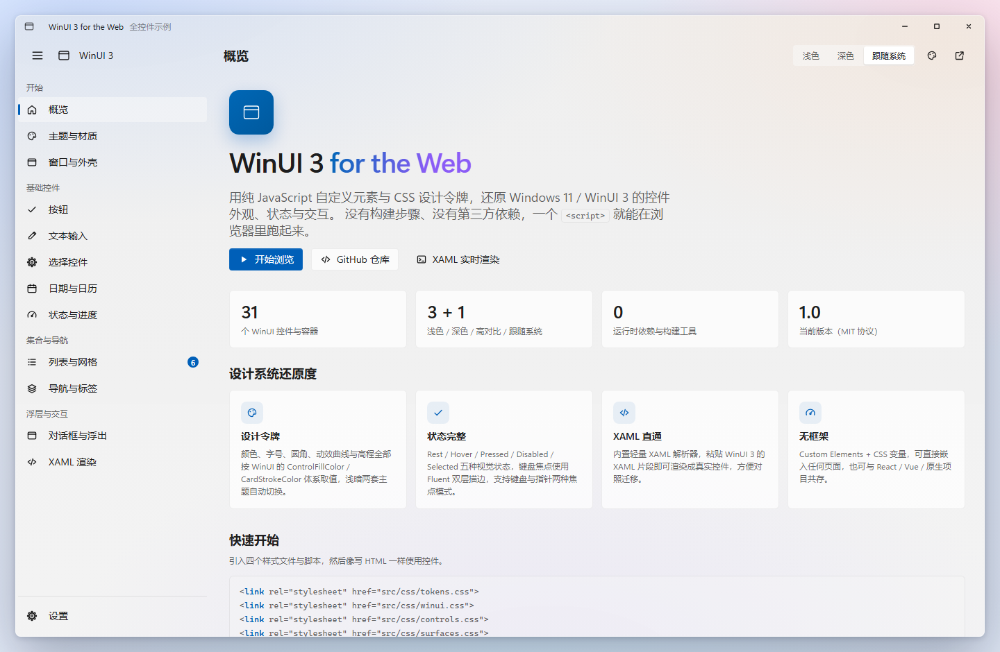

# WinUI 3 for the Web

用 **纯 JavaScript + CSS** 还原 Windows 11 / WinUI 3 的控件外观、状态、主题与交互。零依赖、零框架、无需构建 —— 引入 4 个样式文件与 6 个脚本（或直接用打包好的 2 个文件），即可在浏览器里写出「Windows 11 原生应用」的界面。

> 在线示例：<https://8888888b.github.io/winui3_web/>
>
> 最新版本：**v1.0.0** · [下载 winui3.min.css / winui3.min.js](https://github.com/8888888b/winui3_web/releases/latest)




---

## 特性

- **设计令牌驱动**：颜色、字号、圆角、动效曲线、高程阴影全部取自 WinUI 语义令牌（`ControlFillColor*`、`CardStrokeColor*`、`TextFillColor*` …），改一个 `--wui-accent` 全站联动。
- **三套主题 + 任意强调色**：浅色 / 深色 / 高对比度，支持「跟随系统」（监听 `prefers-color-scheme`）；强调色按 HSL 自动推导 hover / pressed / disabled / tint 阶，并依据相对亮度自动决定强调色上的文字是黑还是白。
- **材质**：Mica（窗口基底）、Acrylic（浮层模糊）、Layer、Card。
- **31 个控件与容器**：见下方清单，全部支持 Hover / Pressed / Disabled / Selected / Focus 五态。
- **Fluent 焦点视觉**：双层描边，可区分键盘焦点与指针焦点（`data-focus-mode`）。
- **完整浮层体系**：ContentDialog（返回 Promise）、Flyout、MenuFlyout、ToolTip、TeachingTip，含边界收敛、上下翻转、焦点陷阱、Esc / 点外关闭。
- **XAML 渲染桥**：把 WinUI 3 的 XAML 片段（`<Button Content="…"/>`）直接渲染成真实控件。
- **无构建**：源码即产物，原生 ES5+ 语法与 Custom Elements，无打包器、无框架、无 polyfill；`dist/` 只是把同一份源码拼成单文件，方便直接引 CDN。

## 快速开始

### 方式一：单文件引入（推荐）

每次发布都会把全部样式与脚本打成两个文件，挂在 [Releases](https://github.com/8888888b/winui3_web/releases) 上，也可以直接引用本站托管的同一份产物：

```html
<!-- 版本化：从 Release 附件下载（可长期固定 v1.0.0） -->
<link rel="stylesheet" href="https://github.com/8888888b/winui3_web/releases/download/v1.0.0/winui3.min.css">
<script src="https://github.com/8888888b/winui3_web/releases/download/v1.0.0/winui3.min.js" defer></script>

<!-- 或者：本站 Pages 托管的 dist（随 main 更新） -->
<link rel="stylesheet" href="https://8888888b.github.io/winui3_web/dist/winui3.min.css">
<script src="https://8888888b.github.io/winui3_web/dist/winui3.min.js" defer></script>
```

第三方 CDN 亦可（jsDelivr 会按 tag 缓存，适合长期引用）：

```html
<link rel="stylesheet" href="https://cdn.jsdelivr.net/gh/8888888b/winui3_web@v1.0.0/dist/winui3.min.css">
<script src="https://cdn.jsdelivr.net/gh/8888888b/winui3_web@v1.0.0/dist/winui3.min.js" defer></script>
```

| 文件 | 体积 | 说明 |
| --- | --- | --- |
| `winui3.min.css` | 59 KB | 设计令牌 + 全部控件样式（压缩） |
| `winui3.min.js` | 115 KB | 全部 Web Components（压缩） |
| `winui3.css` / `winui3.js` | 78 / 127 KB | 同内容未压缩版，便于调试 |

### 方式二：按模块引入源码

```html
<link rel="stylesheet" href="src/css/tokens.css">
<link rel="stylesheet" href="src/css/winui.css">
<link rel="stylesheet" href="src/css/controls.css">
<link rel="stylesheet" href="src/css/surfaces.css">

<script src="src/js/core.js"></script>
<script src="src/js/popup.js"></script>
<script src="src/js/inputs.js"></script>
<script src="src/js/collections.js"></script>
<script src="src/js/overlays.js"></script>
<script src="src/js/xaml.js"></script>
```

顺序有意义：`core.js` 必须最先（定义 `WinUI` 与组件基类），`popup.js` 先于 `overlays.js`。

然后像写普通 HTML 一样使用控件：

```html
<wui-button variant="accent">保存</wui-button>
<wui-button icon="delete" variant="subtle">删除</wui-button>

<wui-textbox header="用户名" placeholder="请输入" clearable></wui-textbox>
<wui-switch checked>实时更新</wui-switch>

<wui-infobar severity="success" title="已完成" message="3 个文件已同步。" closable></wui-infobar>
```

## 控件清单

| 分类 | 控件 |
| --- | --- |
| 导航与容器 | `wui-nav-view`、`wui-tab-view`、`wui-list-view`、`wui-grid-view`、`wui-tree-view`、`wui-expander`、`wui-command-bar`、`wui-breadcrumb`、`wui-pips-pager`、`wui-person` |
| 按钮 | `wui-button`（standard / accent / subtle / hyperlink / accent-outline）、`wui-split-button`、`wui-dropdown-button`、`wui-app-bar-button` |
| 选择 | `wui-checkbox`、`wui-radio`、`wui-switch`、`wui-combobox`、`wui-slider`、`wui-rating` |
| 输入 | `wui-textbox`、`wui-password-box`、`wui-numberbox`、`wui-autosuggest` |
| 日期 | `wui-calendar`、`wui-date-picker` |
| 状态 | `wui-progress-bar`、`wui-progress-ring`、`wui-badge`、`wui-infobar` |
| 浮层 | `WinUI.dialog()`、`WinUI.flyout()`、`WinUI.showMenu()`、`data-tooltip`、`WinUI.teachingTip()` |
| 外壳 | `.wui-window`、`.wui-titlebar`、`.wui-mica`、`.wui-card`、`.wui-settings-card` |

## 主题与强调色

```js
WinUI.setTheme("dark");        // light | dark | high-contrast | system
WinUI.getTheme();              // { mode, resolved }
WinUI.setAccent("#0078d4");    // 任意色值，自动生成各状态色阶
WinUI.getAccent();

WinUI.theme.onChange(({ mode, resolved }) => { /* … */ });
WinUI.accent.onChange((hex) => { /* … */ });
```

也可以用声明式方式：

```html
<html data-theme-mode="dark">   <!-- 首屏即生效，避免闪烁 -->
```

## 浮层 API

```js
// ContentDialog —— 返回按下的按钮
const r = await WinUI.dialog({
  title: "删除项目",
  body: "<p>此操作不可撤销。</p>",
  primaryText: "删除",
  closeText: "取消",
  danger: true,          // 主按钮转危险色
  wide: true,            // 760px 宽版
});

// MenuFlyout
WinUI.showMenu(anchorEl, [
  { label: "打开", icon: "folder", accel: "Ctrl+O" },
  { separator: true },
  { label: "删除", icon: "delete", danger: true },
], { onSelect: (item) => console.log(item.label) });

// Flyout / ToolTip / TeachingTip
WinUI.flyout(anchorEl, "<p>任意 HTML</p>");
WinUI.showToolTip(anchorEl, "提示文字");
WinUI.teachingTip(anchorEl, { title: "新增功能", body: "…", actionText: "知道了" });
```

任何元素加 `data-tooltip="…"` 即可获得 550ms 延迟的 WinUI ToolTip。

## XAML 渲染桥

```js
WinUI.renderXAML(`
  <StackPanel Spacing="12">
    <TextBlock Text="Hello" Style="{StaticResource TitleTextBlockStyle}" />
    <Button Content="确定" />
    <InfoBar Title="提示" Message="来自 XAML" Severity="Success" IsClosable="True" />
  </StackPanel>`, document.querySelector("#host"));
```

支持 `Content` / `Text` / `PlaceholderText` / `IsChecked` / `IsExpanded` / `Severity` / `Margin` / `Padding` / `Spacing` / `Width` / `Orientation` 等属性映射，`{StaticResource …}` 之类的资源引用会被忽略而不报错。

## 事件约定

自定义元素统一派发带 `detail` 的 `CustomEvent`，并与原生事件保持同名互补：

| 控件 | 事件 | `detail` |
| --- | --- | --- |
| 输入类 | `input` / `change` | `{ value }` |
| 勾选类 | `change` / `toggle` | `{ checked }` |
| ComboBox / ListView | `select` | `{ index, value }` |
| NavigationView | `navigate` | `{ page, label, item }` |
| TabView | `select` / `close` / `add` | `{ index }` |

## 目录结构

```
.
├── index.html            # 全控件示例站（单页应用）
├── build.mjs             # 打包脚本：拼单文件 + 保守压缩（零依赖）
├── dist/                 # 构建产物（提交进仓库，同时作为 Release 附件）
│   ├── winui3.css / winui3.js
│   └── winui3.min.css / winui3.min.js
├── src/
│   ├── css/
│   │   ├── tokens.css    # 设计令牌：浅色 / 深色 / 高对比
│   │   ├── winui.css     # 重置、排版、焦点、窗口外壳、Mica
│   │   ├── controls.css  # 按钮、输入、选择、状态类控件
│   │   └── surfaces.css  # 导航、集合、浮层、对话框
│   └── js/
│       ├── core.js       # 令牌读取、图标、主题、强调色、基类
│       ├── popup.js      # 浮层定位、边界收敛、焦点陷阱
│       ├── inputs.js     # 输入与选择类控件
│       ├── collections.js# 导航、列表、树、TabView、日历…
│       ├── overlays.js   # Dialog / Flyout / Menu / ToolTip
│       └── xaml.js       # XAML → DOM 渲染桥
└── docs/preview.png
```

## 构建

```bash
npm run build      # 生成 dist/（含压缩版）
npm run build:raw  # 只生成未压缩版
```

脚本本身零依赖：按固定顺序拼接 `src/css/*` 与 `src/js/*`，再做一次保守压缩 —— 保留换行以规避 ASI 陷阱，并逐字符识别字符串 / 模板串 / 正则字面量，确保多行模板与 `/[&<>"']/g` 这类正则不被误伤。

## 本地预览

任选一种：

```bash
python -m http.server 8080
# 或
npx serve .
```

然后打开 <http://localhost:8080/>。示例站支持深链接：`?page=dialogs&theme=dark`。

## 浏览器支持

面向现代浏览器：Chrome / Edge 111+、Safari 16.4+、Firefox 121+（依赖 Custom Elements、CSS 变量、`color-mix()`、`:has()`）。

## 说明

本项目是**对 WinUI 3 视觉语言的 Web 复刻**，与 Microsoft 无隶属关系；不包含任何 Microsoft 专有代码或字体。图标为按 Fluent 风格手写的 16×16 线性 SVG。

## 许可

[MIT](LICENSE)
